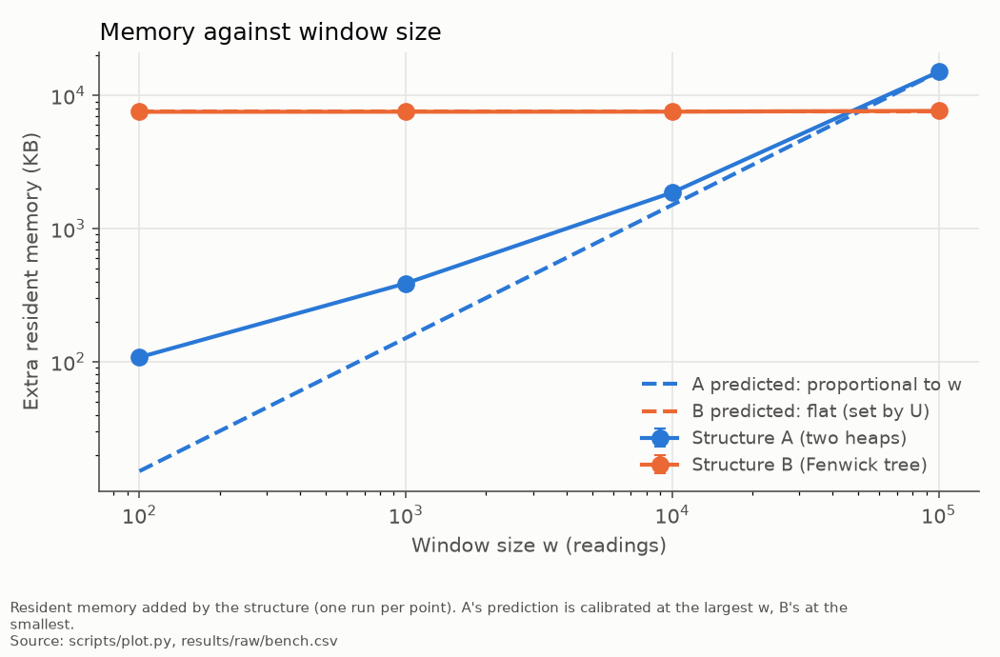
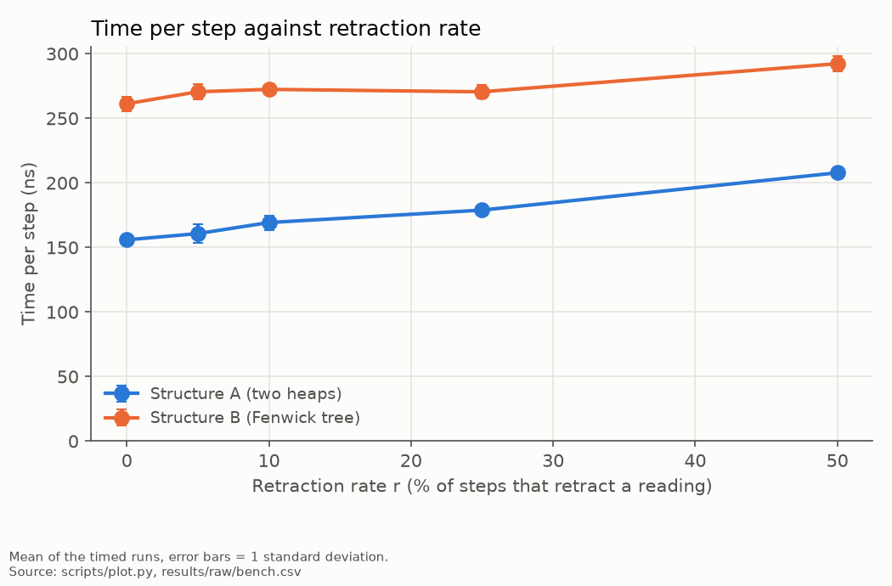
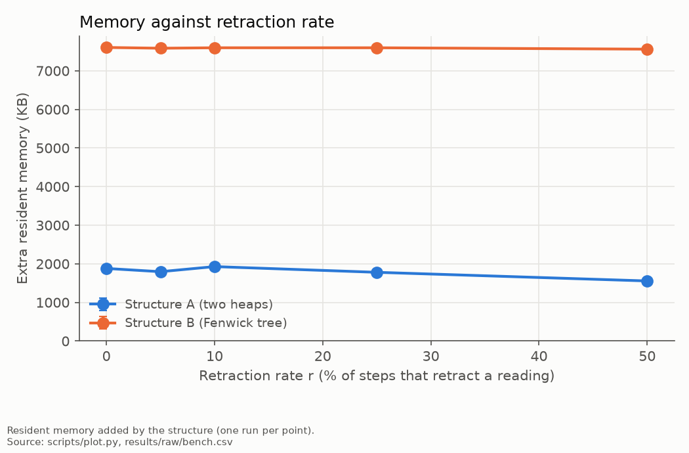
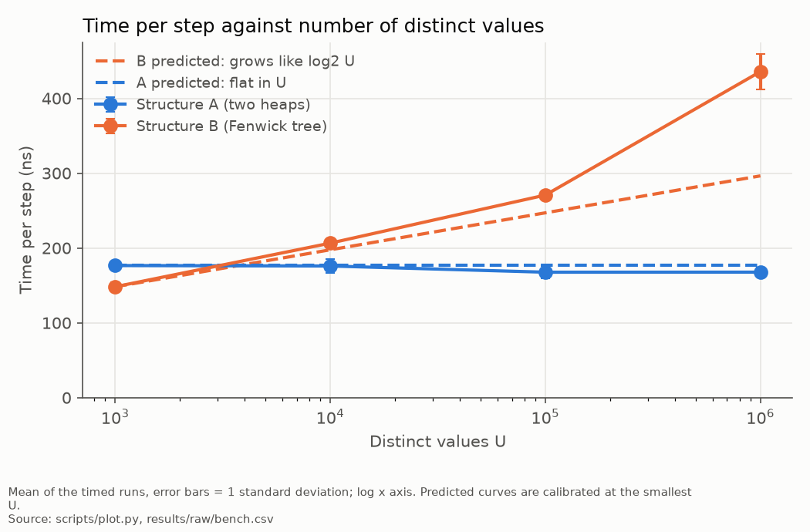
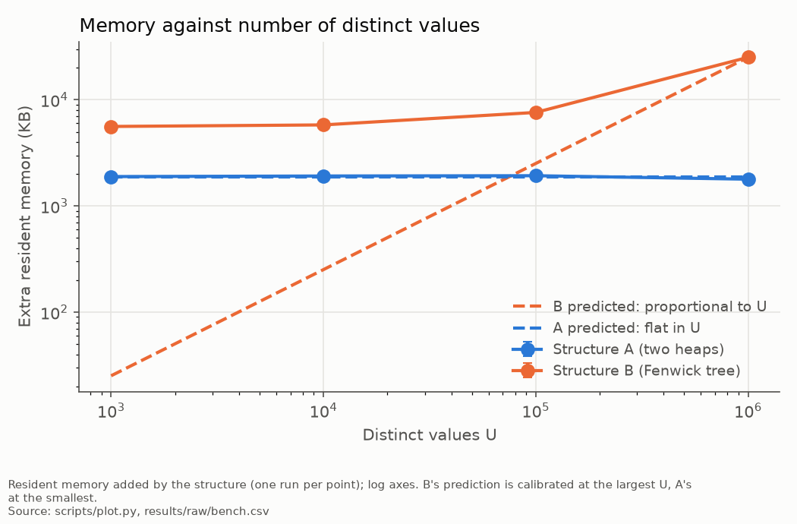

# Running Median with Retractions: Project 8 Report

CS 253 / MA 253, Data Structures and Algorithms Laboratory, 2026

Team: CodeVerse

Repository: https://github.com/vishruthi-cv/Running-median-with-retractions

Structures: A (two heaps with lazy deletion) and B (Fenwick tree over compressed values)

## 1. Team and contributions

We are a team of five, so one member carries two of the six derivations and two of the six roles. The adversary module and the analyst work are both Dwithi’s.

Vishruthi (Structure A). Wrote Structure A myself in C++: a max heap and a min heap holding the two halves of the window, a hash table for ids, and an expiry queue, with retracted values removed lazily. I added a checkConsistency() method to MedianEngine so the oracle can verify it, and the output now matches the oracle for p50 and p90. I also wrote derivation D1. heaps, expiry ques, hashtables were all implemented from scratch without using built in libraries.

Neharika (Structure B). I wrote Structure B: SortedValueTable, FenwickTree, PercentileEngine, the handwritten hash table IdTable, and the adapter PercentileTrackerB that connects it to the shared interface. I wrote my own test (mainB.cpp) and derivation D2. When a reading expires or is retracted the application calls erase(id); inside B the id table finds the value, the sorted table finds its position and the Fenwick tree subtracts one.

Kalyani (Architect and Integration). I designed the IPercentileTracker polymorphic interface so the algorithms stay decoupled from the application, and built the MonitoringApp pipeline that handles live telemetry and threshold breaches. I wrote derivation D3, which proves the heap size ratios. I replaced the early mock maps with the real Structure A and B through the TrackerAAdapter, and built the --eval parser that reads commands from standard input for the auto-grading scripts.

Anushka (Oracle). I wrote a sorted-array oracle and a seeded differential test that compares Structures A and B against it for p50 and p90. The test checks the live counts and Structure A’s consistency over one million insertion steps, with window expiry and random retractions. I documented the seed and the build and run instructions in the README. I also wrote derivation D4.

Dwithi (Adversary and Analyst). In adversary/adversary.cpp I wrote a generator with three patterns (deadheap, monotone, bigdomain) and wrote derivation D5. As Analyst I wrote the benchmark harness bench/bench.cpp, the script scripts/run_all.sh, the plotting script scripts/plot.py and derivation D6, the cost model that we wrote before measuring

## 2. Problem

A monitoring service receives a stream of sensor readings, up to one million of them. At every step it has to report the median of the most recent w readings, where w can be as large as 100,000, and the operators also want other percentiles, for example the 90th. Two kinds of readings leave the window. Expiry is automatic: when a new reading arrives and the window is full, the oldest one drops out. Retraction is arbitrary: an operator can mark any reading as faulty at any time, so it must disappear from the statistics even though it sits in the middle of the window.

What makes it hard is that both kinds of removal hit elements in the middle of the data structure. A heap only removes its top cheaply, so Structure A must delete lazily, and the memory used by that laziness must be bounded by proof. The two-heap method must also be generalised from the median to any fixed percentile while keeping O(log n) updates. Finally, we compare against the published running-median method of Härdle and Steiger.

The application replays a stream, reports the windowed median at every step (and the 90th percentile from Structure B), and raises an alert when the 90th percentile crosses a threshold. For each new reading it calls insert(id, value). When a reading expires or is retracted it calls erase(id). For the report it calls getMedian() and getPercentile(90.0).

Scale we worked at. Streams of 10^6 readings; window sizes w from 10^2 to 10^5; the number of distinct values U and the retraction rate r varied in the experiments of section 11; fixed seed 1 for the benchmarks.

## 3. Interface and invariants

All structures, and the oracle, are used through one abstract class, IPercentileTracker (see INTERFACE.md):

The contract. (1) An empty window returns -1.0 from both getMedian() and getPercentile(p). (2) For an even count N the median is the average of the two middle values, (v[N/2 - 1] + v[N/2]) / 2.0 (zero-based, sorted). (3) The p-th percentile is the nearest-rank value: the k-th smallest with k = ceil(p/100 · N), clamped to 1..N. (4) Ids are unique; inserting an id that is already live is ignored.

Structural invariants that our checkers test.

Structure A:

A1. Every entry in the lower heap is at most every entry in the upper heap (live entries), and each heap satisfies its heap order.

A2. The live count of the lower heap equals ceil(p·n) (for the median, it equals the live count of the upper heap or one more), and lowLive + highLive equals the number of live readings.

A3. An entry is dead if and only if its id is in the pending-removal table; a removed value is never reported by a query.

A4. After purging, dead entries are at most θ times the live entries (we use θ = 1), so physical heap size stays below about (1 + θ)·w.

Structure B:

B1. SortedValueTable holds the distinct stream values in strictly increasing order.

B2. Each Fenwick cell F[i] equals the sum of the live counts on the block (i - lowbit(i), i].

B3. Every count is zero or more.

B4. total equals the sum of all counts and also the number of entries in IdTable; every live id appears once with the value that was counted for it.

Oracle: the array is sorted and holds exactly the live values.

Application: ids are unique, and the window never holds more than w live readings.

A1 – Heap validity: The lower heap must satisfy the max-heap property and the upper heap must satisfy the min-heap property. This corresponds to R1, checked by checkConsistency().

A2 – Bookkeeping consistency: Every heap element must have exactly one hash-table record, with the correct heap side and live/dead status. The live counters and dead-item count must also match. This corresponds to R2.

A3 – Balance and ordering: The number of live elements in the lower heap must be ceil(n/2), and every live element in the lower heap must be ≤ every live element in the upper heap. These correspond to R4 and R3, respectively.

A4 – Valid live tops / median condition: If a heap contains live elements, its top must be live. Together with the balance and ordering conditions, this ensures that the top of the lower heap gives the required median. This corresponds to R5.

## 4. Structure A: two heaps with lazy deletion

Representation. MedianEngine keeps the window in two heaps written from scratch. low is a max heap (class MaxHeap) holding the smaller part of the readings, and high is a min heap (class MinHeap) holding the larger part. For the median, the top of low is the answer. Each heap entry is an Item with a reading’s id and value. A hand-written HashTable stores the ids of readings that have been removed but are still physically inside a heap (the pending removals). An ExpiryQueue, a circular buffer of ids with capacity w, remembers the arrival order so that the oldest id can expire. The engine also keeps lowLive, highLive, the number of dead items and the number of purges. No library container stands in for any of these parts.

Operations.

Why lazy deletion needs a purge. A dead entry that is buried deep in a heap is never reached by popping, so without a purge dead entries could grow without bound (the adversarial inputs of section 8 build exactly that). We purge when dead entries exceed θ times the live entries, with θ = 1. A purge rebuilds both heaps in about (1 + θ)·w steps, and at least θ·w retractions are needed to create that many dead entries since the previous purge, so the amortised cost per retraction is (1 + θ)/θ, a constant. Physical heap size therefore stays below about 2·w, and the pending table holds at most about w entries. The proof is derivation D5 (bound) and D6 (cost).

Generalising to a fixed percentile. The sizes of the halves are kept in the ratio p : (1 - p) instead of 1 : 1, so low holds the ceil(p·n) smallest live readings and its top is the p-th percentile. Because each update changes n by one, the target size changes by at most one and only one or two items have to cross, each in O(log n). This is derivation D3.

Invariants it maintains. A1 to A4 of section 3. The key one, from D1, is that after every insertion, expiry and retraction the live lower heap has as many elements as the live upper heap or one more, every lower element is at most every upper element, and then the top of the lower heap is the median.

Design decisions and rejected alternatives.

Lazy deletion with a hash table of pending removals, not eager removal. Eager removal from the middle of a heap needs every element to know its position, and that bookkeeping must be updated on every swap during sifting. Lazy deletion keeps retraction at O(1) and moves the work into one rebuild that is paid for by the retractions.

Purge when dead outnumber live (θ = 1). A smaller θ purges more often (cost per retraction 1 + 1/θ grows) and a larger θ allows more memory ((1 + θ)·w). θ = 1 balances the two.

Own heaps, hash table and queue. The project rules forbid library containers standing in for the structures under study.

Sorted array or balanced tree instead of heaps. A sorted array needs O(n) shifting per insert. A balanced tree with subtree sizes works in O(log n) but is heavier and does not match the two-heap method that the project asks us to study.

Measured number of purges of Structure A in experiment E2: 98 at r = 0%, rising slowly to 125 at r = 50% (raw data: results/raw/bench.csv).

## 5. Structure B: Fenwick tree over compressed values

Idea. Instead of keeping the readings in order, Structure B keeps one counter for every distinct value. An insertion adds one to the counter of its value. An expiry or a retraction subtracts one. Where the reading sat in the window does not matter, so there are no dead entries and nothing to purge. The k-th smallest live value is found by walking along the counters, and a Fenwick tree makes that walk take O(log U) instead of O(U).

Representation. Five small classes, all written from scratch:

The id table exists because a retraction gives only the id of the reading, while the tree works on values. The id table remembers which value each id carried, so erase(id) can subtract it.

Operations and cost.

IdTable uses 100003 buckets for up to 10^5 live readings, so a lookup touches about one entry on average (expected O(1)). Total memory is O(U + w): the table and the tree are of size U, and the id table holds one entry per live reading.

The descent. To find the k-th smallest, start at position 0 and try jumps of size T, T/2, …, 1, where T is the largest power of two not above U. Take a jump from pos to pos + step only if the block count F[pos + step] is smaller than k, and then subtract that count from k. After the last step, pos + 1 is the position of the k-th smallest and valueAt turns it into the value. It is correct because at step s the position is a multiple of 2s, so the cell pos + s covers exactly the next block of size s, and after each step the answer lies in a window after pos that halves. The full proof is derivation D2 (Appendix A).

Median and percentile. For N live values the median is the middle one (the average of the two middle ones when N is even, as the contract says), and the p-th percentile is the k-th smallest for k = ceil(p/100 · N). In the code, percentile subtracts a tiny constant (10^-9) before taking the ceiling, because decimal numbers are stored only approximately and p · N could otherwise come out as 9.000000001 and round up to the wrong rank.

Invariants it maintains. B1 to B4 of section 3.

Design decisions and rejected alternatives.

Offline coordinate compression instead of indexing by value. Readings can be decimals or large numbers, so an array indexed by the raw value is impossible. Sorting the distinct values once keeps the tree at size U. The price is that all values must be known before the run starts (fine for a replay, and it is exactly what the adversary’s bigdomain pattern attacks).

Fenwick tree instead of a balanced tree with subtree sizes (an order-statistic tree). A balanced tree does not need U in advance, but the Fenwick tree lives in one flat array, has small constants, uses little memory per element and has a very short query.

Binary lifting descent instead of repeated prefix sums. Binary search on the answer with a prefix-sum call each time costs O(log^2 U). The descent reads the answer in one walk, O(log U).

Hand-written hash table instead of std::unordered_map. The project rules forbid library associative containers standing in for a structure under study, so IdTable is separate chaining with a prime number of buckets. An early version of the adapter used unordered_map; we replaced it after checking the rules (bug log, section 7).

An adapter class instead of changing the interface. PercentileTrackerB translates between the shared interface and the engine, so Structure A, Structure B and the oracle all plug into the same application.

Behaviour at the edges. A value that was not in the list given at the start has no position; it is ignored by insert and update is refused, so it can never break the tree. clear() rebuilds an empty engine and an empty id table from a saved copy of the value list.

Testing. mainB.cpp compares the engine with a plain sorted vector for 1,000,000 random insert and remove steps (live count kept between 1,000 and 3,000, seed 20260928), and the tracker (ids, erase from the middle, getMedian, getPercentile) for 200,000 steps, plus a small hand-checkable test of the empty window, update, erase and clear. It prints ALL TESTS PASSED.

## 6. The requirement beyond the lecture

## 6.1 Fenwick’s cumulative frequency tables (Structure B)

The part of the project that comes from the reading list is P. M. Fenwick’s “A new data structure for cumulative frequency tables” (1994). As we read it, the paper keeps a table of counts in an array where each cell stores a partial sum over a block whose length is given by the last 1-bit of its index, so that adding to a count and reading a cumulative frequency both take a number of steps proportional to the logarithm of the table size.

How we implemented it. We use the tree to store counts of live readings per compressed value. FenwickTree::add is the standard update (add to a cell, then move to the next cell by adding its last 1-bit). The query we need is not a prefix sum but its inverse, “which position holds the k-th item”, and we implemented that as a binary-lifting descent (FenwickTree::findKth) and proved it in D2.

Where we differ from the paper. The paper is about cumulative frequencies of symbols; we add (a) coordinate compression so that decimal readings can be used as positions, (b) the id table so that readings can be removed by id, and (c) the percentile arithmetic on top

Fenwick describes finding the symbol corresponding to a given cumulative frequency by traversing the binary-indexed structure using the binary representation of the index. Our findKth uses the same binary-lifting idea to find the position containing the k-th item, so it is the same underlying method, adapted to our count/percentile setting.

## 6.2 Härdle and Steiger’s optimal running median

The project asks us to compare with W. Härdle and W. Steiger, “Optimal median smoothing” (1995). As we understand it, their method keeps the window’s readings inside a pair of heaps that live together in one array, and links each reading with its place in the heaps, so when the window slides the oldest reading can be replaced directly in O(log w) time without any lazy deletion.

Difference from ours. That method is built for a window that slides one reading at a time and always drops the oldest. Our problem also allows a reading to be retracted from any position at any time, which is why Structure A uses lazy deletion and a purge. We did not implement or measure the Härdle-Steiger method, so no measured time or memory for it appears next to A and B in section 11. This comparison is a limitation (section 12).

## 7. Correctness

The oracle. The oracle is a sorted array maintained using binary-search insertion and deletion. It is intentionally slow: each insertion or deletion may shift (O(w)) elements. It is correct by construction because it always contains exactly the live values in sorted order. Therefore, the median and every percentile can be read directly from their required positions, using the same contract as the two structures: the average of the two middle values for an even-sized window and the nearest-rank rule for percentiles. Since the oracle is implemented independently of both the heap-based and Fenwick-tree structures, a disagreement with it indicates an error in one of those structures.

The differential test. The same sequence of operations is applied to Structure A, Structure B, and the oracle. The test includes insertions, window expiry, and random retractions of live IDs from anywhere in the window. After every operation, it compares the p50 and p90 results of both structures with the oracle, checks that the live counts agree, and runs checkConsistency() on Structure A. The test runs for (10^6) steps using a fixed seed, making the sequence reproducible. The test completes with ALL TESTS PASSED.

Unit tests for Structure B. mainB.cpp provides an additional independent test suite for Structure B. It runs (10^6) engine operations and (2\times10^5) tracker operations against a sorted vector, using fixed seeds 20260928 and 12345. The tests also verify interface-level rules: an empty window returns -1.0, the median of an even number of values is averaged, erase returns true when an item is actually removed and false when it is not present, and clear correctly resets the structure. The tests finish with ALL TESTS PASSED.

Invariant checkers. Structure A has checkConsistency(), which directly checks its heap, bookkeeping, ordering, balance, and live-top invariants from Section 3. Structure B is checked end-to-end through comparison with the independent oracle. Because the Fenwick tree stores counts for compressed values, an incorrect count would eventually produce an incorrect k-th position and therefore a disagreement with the oracle. This provides an independent check of the correctness of the Fenwick-based percentile computation.

## 8. Adversarial inputs

The generator is adversary/adversary.cpp. It writes a text stream of operations, I value (insert), R id (retract) and Q (query), and is seeded, so every stream can be reproduced exactly. It has three patterns, one for each weakness that the project asks us to attack.

Worst-case argument (derivation D5). Without a purge, a reading that is retracted while it is buried is only flagged, and a flagged entry leaves a heap only when it reaches the top. A sequence that retracts n/2 buried readings therefore leaves Θ(n) dead entries inside the heaps. With a purge at threshold θ (rebuild when dead entries exceed θ times live entries), the number of dead entries never exceeds θ times the live entries by more than one operation’s worth, so the physical size stays below (1 + θ) times the live size. For B there is no dead storage, but its memory is Θ(U), so bigdomain makes B use much more memory than its live count needs.

Measured effect. We did not run a measured comparison of these inputs against random input, so there is no measured time or memory for the three patterns and no prediction from section 9 to compare with them. This is a limitation (section 12).

## 9. Predicted cost model (written before measuring)

Commit that added this model: 758d8fd, committed on 11 November 2026 (before any measurement, and older than the files in results/raw).

Notation: w = window size (live readings), U = distinct values, r = fraction of readings retracted early, θ = purge threshold (purge when dead entries exceed θ times live entries; we use θ = 1). Both expiry and retraction are retract (erase) calls.

Structure A (two heaps, lazy deletion, purge). Time per operation is about c1 · log2(w) for heap push, sift and rebalancing, plus an amortised purge term. A purge costs about (1 + θ) · w steps, and at least θ · w retractions are needed to create that many dead entries since the last purge, so the amortised purge cost per retraction is (1 + θ)/θ = O(1) for fixed θ. In total, O(log w) amortised: T_A = c1 · log2((1 + θ) · L) + c2 · (1 + 1/θ), where L is the live count. Memory: heap entries stay below about (1 + θ) · w (about 2 · w for θ = 1), plus a pending table of at most about θ · w entries. Effect of r: more retractions mean more dead entries and more purges, so time per operation should rise slowly with r and stay bounded by the O(1/θ) purge term.

Structure B (Fenwick tree over compressed values). About log2(U) per operation (a binary search of the sorted table plus a tree walk), independent of w. Memory O(U + w), flat in r.

Oracle (reference only). Binary search is O(log w), but shifting makes each insert and delete O(w), so time should grow roughly linearly with w.

Numbers to check against the measurements.

What could make the model wrong. If the measured growth is larger than predicted, possible causes are cache effects and memory allocation. We do not claim cache effects without profiler output.

## 10. Experimental setup

bench/bench.cpp writes one CSV row per run into results/raw/. scripts/run_all.sh builds, runs the check, runs the experiments E1 (vary w), E2 (vary the retraction rate r) and E3 (vary the number of distinct values U), and then calls scripts/plot.py, which draws seven figures. The dashed prediction curves are calibrated at one point, so the comparison is about the shape and not about an absolute constant.

## 11. Results

Every number and figure in this section comes from results/raw by scripts/run_all.sh. Each plotted point is the mean of five runs with the standard deviation as error bars, and axes are logarithmic where w or U spans several orders of magnitude.

### Experiment E1: vary w (10^2 to 10^5). Predictions: A grows with log2 w (at least 2.5 times from the smallest to the largest w), B stays roughly flat, the oracle grows roughly linearly with w.

### Experiment E2: vary the retraction rate r. Predictions: A’s time rises slowly with r and stays bounded by the purge term, A’s memory stays between w and about 2w entries, B is flat in both.

### Experiment E3: vary the number of distinct values U. Prediction: B’s time per operation grows like log2 U and its memory like U; A does not depend on U.

All figures are made by scripts/plot.py from results/raw/bench.csv. Each time point is the mean of 5 timed runs, and each memory point comes from one warm-up run (see section 12). Dashed lines are predictions, fixed at one point (the smallest w, or the largest value for the memory figures), so only their shape is a prediction. The commit with the cost model is 758d8fd (11 November 2026), before any measurement. Experiment settings: E1 varies w (100, 1,000, 10,000, 100,000) with U = 10^5 and a retraction rate of 10%; E2 varies r (0, 5, 10, 25, 50%) with w = 10^4; E3 varies U (10^3, 10^4, 10^5, 10^6) with w = 10^4 and r = 10%; p = 50 throughout.

> **Figure placeholder:** `results/figures/fig1_time_vs_w.png`

Figure 1. E1: time per operation against w (log axes), Structure A, Structure B and the oracle, with dashed prediction curves. Script: scripts/plot.py. Raw data: results/raw/bench.csv. B is flat at about 261 ns, as predicted. A grows from 146 to 207 ns, a factor of 1.4, where we predicted at least 2.5 (log2 w goes from 6.6 to 16.6), so A grows less than predicted. The oracle’s running time was not measured, so it is not in this figure.

> **Figure placeholder:** 

Figure 2. E1: resident memory against w, Structure A and Structure B. Script: scripts/plot.py. Raw data: results/raw/bench.csv. A grows with the window, from 0.1 MB at w = 100 to 15 MB at w = 100,000, while B stays at about 7.5 MB whatever w is. A’s heaps hold at most about 1.9 w entries (190,343 at w = 100,000), below the bound of 2w from D5 and D6.

> **Figure placeholder:** 

Figure 3. E2: time per operation against the retraction rate r, with prediction. Script: scripts/plot.py. Raw data: results/raw/bench.csv. A rises from 156 to 208 ns as r goes from 0% to 50%, and B from 261 to 292 ns, which matches the prediction that time rises slowly with r.

> **Figure placeholder:** 

Figure 4. E2: resident memory against r, with prediction. Script: scripts/plot.py. Raw data: results/raw/bench.csv. B is flat at about 7.5 MB and A stays between 1.6 and 1.9 MB with no growth, as predicted.

> **Figure placeholder:** 

Figure 5. E3: time per operation against the number of distinct values U (log axis), with prediction. Script: scripts/plot.py. Raw data: results/raw/bench.csv. A is flat (177 to 168 ns), as predicted. B grows from 148 to 436 ns, a factor of 2.9 where we predicted about 2, and most of the extra slowdown is at U = 10^5 and above, where B’s tables are large.

> **Figure placeholder:** 

Figure 6. E3: resident memory against U. Script: scripts/plot.py. Raw data: results/raw/bench.csv. A is flat at about 1.9 MB. B grows from 5.6 MB at U = 10^3 to 25 MB at U = 10^6 and is almost flat below U = 10^5, because it has a fixed floor of about 5.6 MB that the model missed.

> **Figure note:** : the adversarial patterns were not run in a measured comparison

Figure 7. Adversarial patterns deadheap, monotone and bigdomain: time and memory for A and B. Script: scripts/plot.py. Raw data: none. We did not run a measured comparison of these inputs against random input, so there is nothing to plot for this figure (see section 8 and section 12).

### Prediction against measurement.

### Gaps between prediction and measurement.

A grows less than predicted with w (Figure 1). We predicted a factor of at least 2.5 from w = 10^2 to w = 10^5, because log2 w goes from 6.6 to 16.6, and measured 1.4 (146 to 207 ns). A likely reason is that part of A’s cost per step does not grow with w (the hash table lookup, the loop and the query), while the model treated all of it as growing with log2 w. We did not prove this, and we ran no profiler.

B grows more than predicted with U (Figure 5). We predicted a factor of about 2, since log2 U goes from 10 to 20, and measured 2.9 (148 to 436 ns). Most of the extra slowdown is at U = 10^5 and above, where B’s tables are large. A likely reason is cache effects, but we have no profiler output, so this is a hypothesis and not a finding.

B’s memory has a floor the model missed (Figure 6). We predicted memory proportional to U. B has a fixed floor of about 5.6 MB, and above it B uses about 19.6 bytes per value, against our estimate of 16. A likely reason for the floor is B’s id table, which has a fixed 100,003 buckets (about 2.4 MB before any reading arrives), but we did not measure this.

The oracle was not measured. The prediction that the oracle’s time grows roughly linearly with w could not be checked, because its running time was not measured in these experiments.

What we expect to discuss. B’s work per operation includes a binary search in the sorted table and a tree walk of about log2 U steps each, so it should depend on U and not on w. A’s work depends on w through the heap height and on r through the purges. If B is not flat in w, the likely cause is memory access patterns of the id table, and we will say so only if the measurements show it.

## 12. Limitations

B needs all values in advance. The compressed domain is built before the run, so Structure B works for a replay but not for an unbounded live stream. A value outside the list is ignored.

B’s memory depends on U, not on w. The bigdomain pattern makes that visible.

The id table has a fixed size. IdTable uses 100003 buckets, which suits w up to 10^5; with many more live ids the chains grow and lookups slow down.

clear() in B rebuilds from a saved copy of the value list, which costs time and some extra memory.

A’s purge is amortised, not worst-case. One retraction can trigger a rebuild of O(w) work; the average is constant but a single operation can be slow.

Härdle and Steiger comparison. We did not implement or measure the Härdle-Steiger method. Section 6.2 compares it with our design in words only, and no measured time or memory for it exists.

Measurements. One machine, one compiler setting and one seed for the benchmarks; no profiler counters.

### What we would do differently or measure next: profile cache misses with hardware counters; vary θ; try a dynamic compression for B that does not need the values in advance; run the benchmarks on a second machine.

## 13. References

J. W. J. Williams, “Algorithm 232: Heapsort,” Communications of the ACM 7(6):347-348, 1964.

R. W. Floyd, “Algorithm 245: Treesort 3,” Communications of the ACM 7(12):701, 1964.

P. M. Fenwick, “A new data structure for cumulative frequency tables,” Software: Practice and Experience 24(3):327-336, 1994.

W. Härdle and W. Steiger, “Optimal median smoothing,” Journal of the Royal Statistical Society, Series C (Applied Statistics) 44(2):258-264, 1995.

T. H. Cormen, C. E. Leiserson, R. L. Rivest and C. Stein, Introduction to Algorithms, 3rd ed., MIT Press, 2009: Chapter 6 (heaps) and Chapter 9 (medians and order statistics).

R. Sedgewick and K. Wayne, Algorithms, 4th ed., Addison-Wesley, 2011: section 2.4 (priority queues).

Tools: g++ 16.2.0, GitHub, Visual Studio Code. AI assistants (Claude, ChatGPT) were used by some members for explanations, first drafts of code and of this text. Every use is declared in TOOLS.md, and each member checked and can explain what they submitted.

### What we would do differently:

Explore better ways to handle deletions, such as indexed heaps.

Experiment with different purge thresholds.

Improve support for dynamically changing value ranges.

### What we would measure next:

Performance at different retraction rates.

Behaviour with different value distributions.

Performance for other percentiles.

Memory usage and cache misses.

## Appendices (not counted in the page limit)

- Appendix A: D1, Structure A two-heap rule (D1.md)

- Appendix B: D2, binary-lifting descent (D2.md)

- Appendix C: D3, fixed percentile with size ratio p : (1 - p) (D3.md)

- Appendix D: D4, checker is necessary and sufficient (D4.md)

- Appendix E: D5, adversarial sequence and purge bound (D5.md)

- Appendix F: D6, cost models (D6.md)

- Appendix G: TOOLS.md, AI and tool declaration

